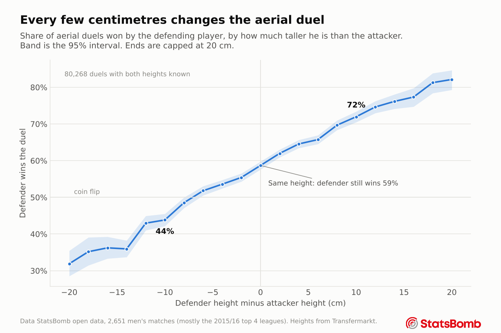
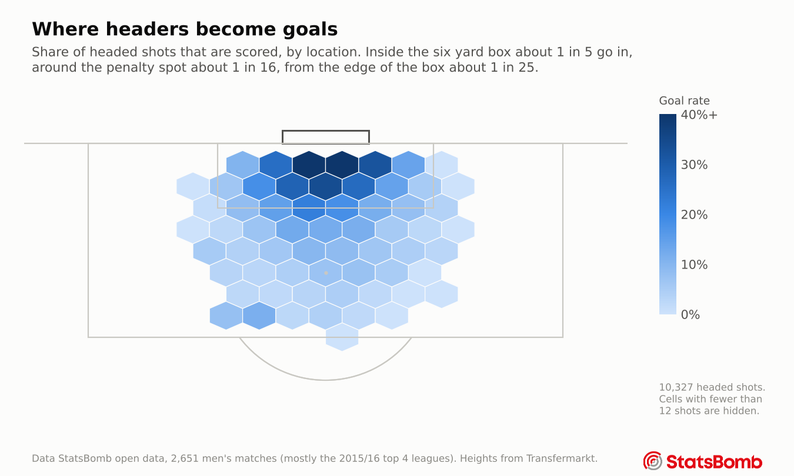
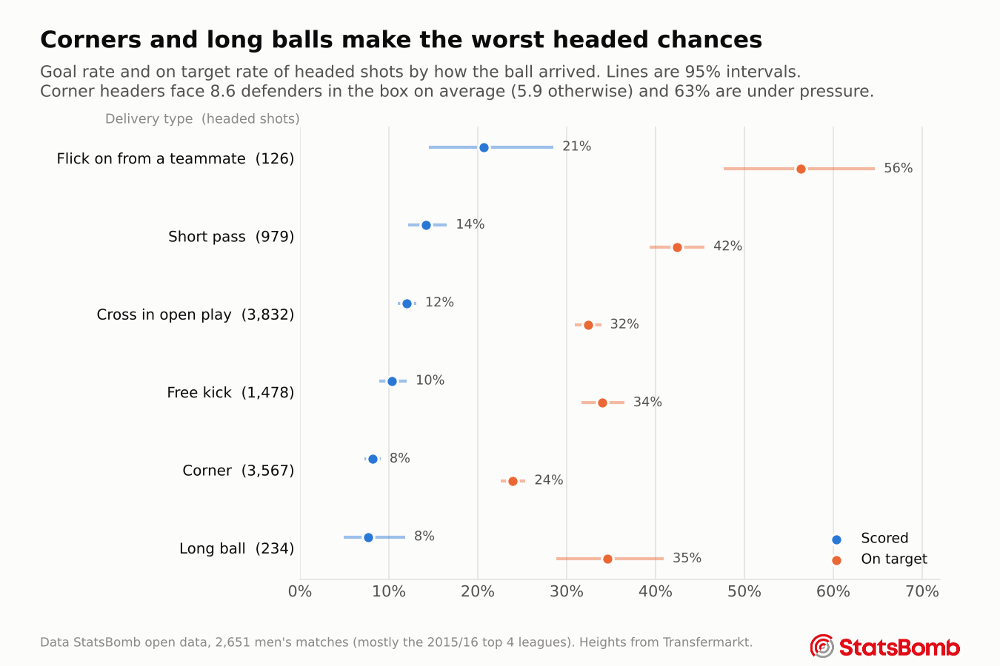
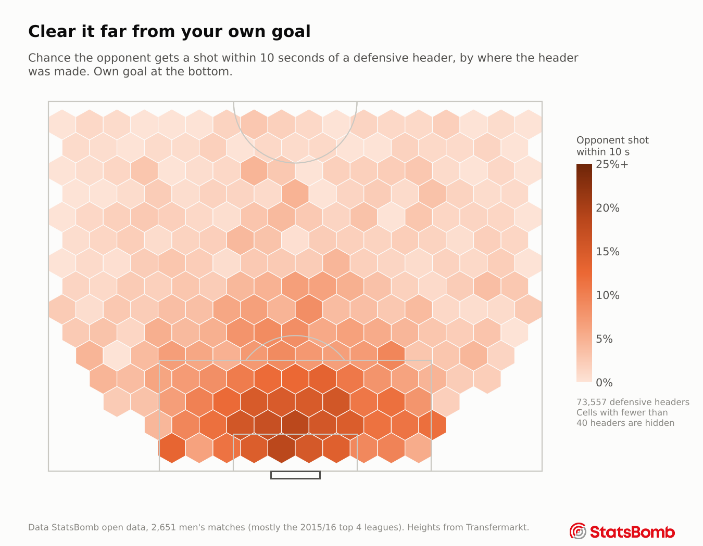
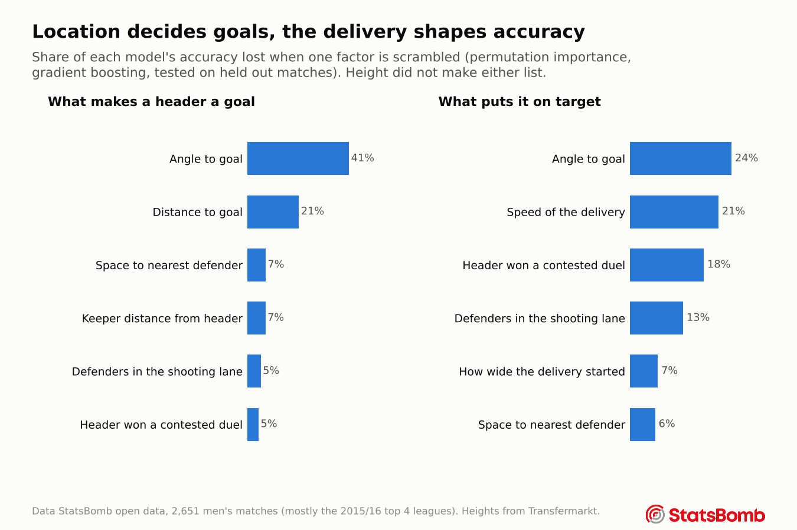
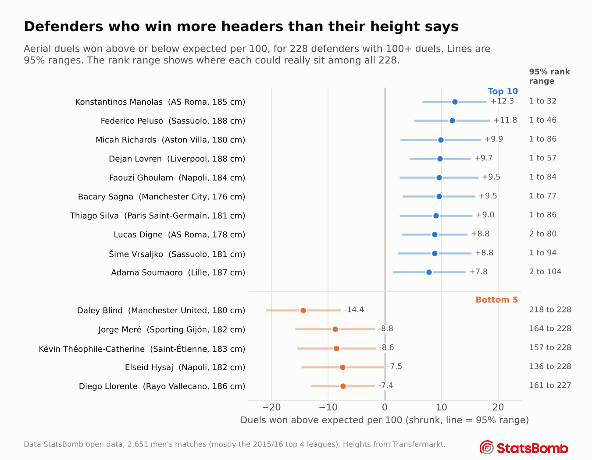
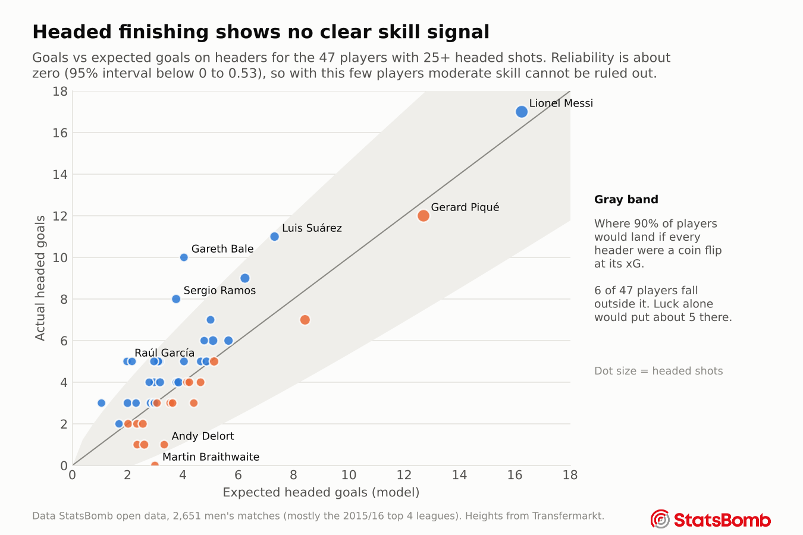
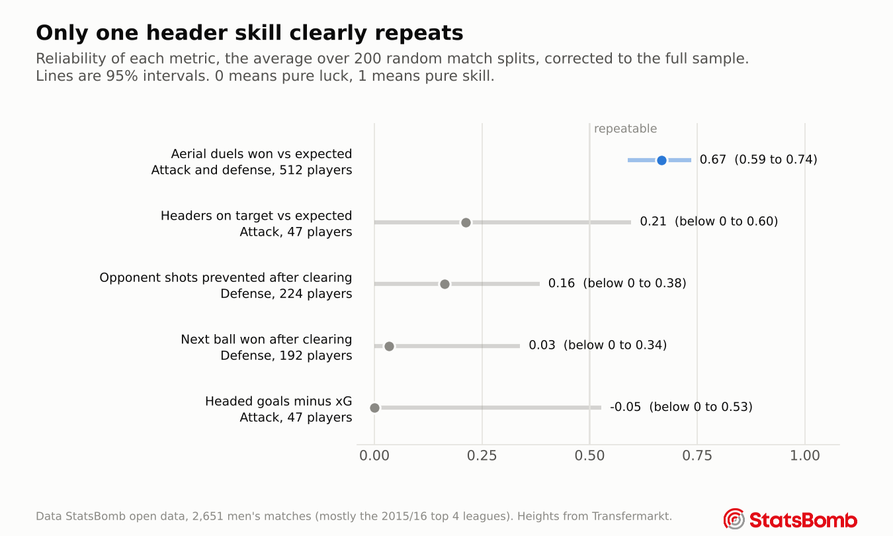
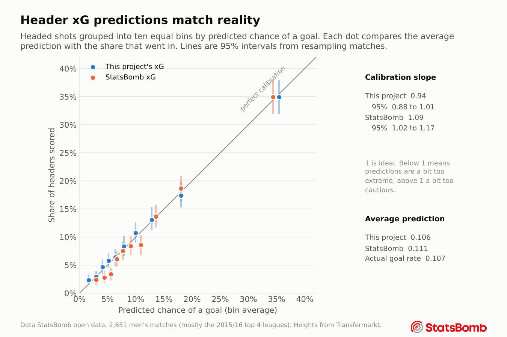
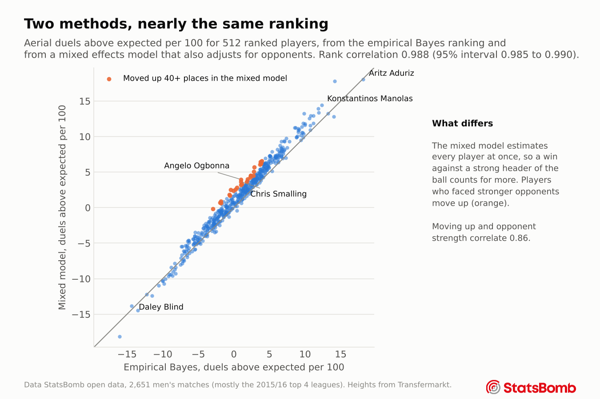

# Header quality in football

How good are players with their heads, in attack and in defense, once you account for the situation they were in? This project builds expected-value models for headers from free event data and uses them to rank players, then checks which of those rankings measure a real skill and which are mostly luck.

**Read the illustrated version** at [lipealiseda.github.io/header-quality](https://lipealiseda.github.io/header-quality/), six short chapters with a searchable player table, or the one page summary in [WRITEUP.md](WRITEUP.md).



## Main findings

- Winning aerial duels is a repeatable skill. Split-half reliability is 0.67 (95% interval 0.59 to 0.74, over 200 random match splits) even after the model accounts for both players' heights, positions, the delivery and the location.
- Height is the biggest single driver of who wins a duel, 30% of the duel model's accuracy (range 26% to 35%) when both heights and their difference are shuffled together in permutation importance, first in all 15 repeats. A defender 10+ cm taller than his man wins 76% (95% interval 75% to 77%), one 10+ cm shorter 39% (38% to 40%).
- Height does not help once the header is won. Taller players do not beat their headed xG.
- Headed goals minus xG shows no sign of being a skill (reliability about 0), but with only 47 qualified players the 95% interval reaches 0.53, so moderate finishing skill cannot be ruled out either.
- The header xG model (logistic regression, AUC 0.743, 95% interval 0.728 to 0.758) cannot be told apart from StatsBomb's own xG on the same shots (difference -0.006, interval -0.014 to +0.003, paired match bootstrap p = 0.20), and it is better calibrated there.
- Player rankings come with honest uncertainty. The top defender in the air, Konstantinos Manolas, has a 95% rank range of 1 to 32 among 228 defenders. Only 18 defenders are clearly above average and 8 clearly below.

## Charts

| Attack | Defense |
|---|---|
|  |  |
|  |  |
|  |  |
|  |  |

## Data

| Source | What it gives | Licence |
|---|---|---|
| [StatsBomb open data](https://github.com/statsbomb/open-data) | Events, shot freeze frames, 360 frames, lineups for 2,651 men's matches | StatsBomb public data user agreement. Free for research, no redistribution of the raw data, analysis must credit StatsBomb with their logo |
| [Transfermarkt dataset by dcaribou](https://github.com/dcaribou/transfermarkt-datasets) | Player height, birth date, nationality, club history | CC0 |
| [EA FC player ratings by Stefano Leone](https://www.kaggle.com/datasets/stefanoleone992/fifa-22-complete-player-dataset) | Video game ratings (jumping, strength, heading, sprint speed, weight), FIFA 15 to 22. Side test only | Scraped from sofifa.com. Not republished here |
| [Metrica Sports sample data](https://github.com/metrica-sports/sample-data) | Two anonymised games of tracking data (Stage 5 only) | Free to use, public use should acknowledge Metrica Sports |

The raw data is **not** in this repository, because the StatsBomb agreement does not allow redistributing it. The scripts download it.

| Dataset built in Stage 2 | Rows |
|---|---|
| Headed shots | 10,327 (1,101 goals) |
| Aerial duels with both players known | 95,942 |
| Defensive headers (headed clearances, plus headed passes in a team's own third after an opponent's ball) | 75,968 |

Column definitions are in [docs/data_dictionary.md](docs/data_dictionary.md).

## Models

Every model is fit twice, as a logistic regression and as a gradient boosting model (scikit-learn `HistGradientBoostingClassifier`), and scored with 5 fold cross validation grouped by match. Intervals are 95% match bootstrap intervals (1,000 resamples of whole matches, recomputed on the out of fold predictions).

| Target | Rows | Best model | AUC (95%) | Log loss skill (95%) | Brier | Calibration slope (95%) |
|---|---|---|---|---|---|---|
| Headed shot is a goal (xG) | 10,327 | Logistic | 0.743 (0.728 to 0.758) | 11.8% (10.1% to 13.3%) | 0.0856 | 0.94 (0.88 to 1.01) |
| Headed shot is on target | 10,327 | Logistic | 0.628 (0.617 to 0.640) | 3.6% (2.9% to 4.3%) | 0.2045 | 0.89 (0.82 to 0.97) |
| Defending player wins the aerial duel | 93,684 | Boosting | 0.667 (0.663 to 0.670) | 6.5% (6.2% to 6.7%) | 0.2220 | 1.04 (1.01 to 1.06) |
| Opponent shoots within 10 s of a defensive header | 75,968 | Boosting | 0.739 (0.733 to 0.745) | 10.6% (10.1% to 11.1%) | 0.0729 | 1.03 (1.00 to 1.07) |
| Defending team wins the next ball | 68,844 | Boosting | 0.694 (0.689 to 0.698) | 11.1% (10.7% to 11.5%) | 0.2134 | 1.05 (1.03 to 1.08) |

Every model's calibration curve is in [results/calibration_all_models.png](results/calibration_all_models.png). Header xG is compared with StatsBomb's xG on the same shots with a paired match bootstrap and DeLong's test. Full results, including the effect of adding height, are in [results/stage3_summary.md](results/stage3_summary.md).



Two choices worth knowing about.

1. StatsBomb's `under_pressure` flag was dropped from the attack models. It duplicates the distance to the nearest defender, and with both in the model the flag took a misleading positive sign even though pressured headers score about half as often.
2. Whether a defensive header was logged as a Pass or a Clearance was kept out of the clearance models, because StatsBomb tends to log a header as a pass when it reaches a teammate, which would leak the outcome.

## Stage 5, speed from tracking data

Free event data has no speed, so a small side test uses Metrica Sports' two anonymised sample games (25 frames per second). For 38 aerial duels where both players are tracked, speed, peak speed, run up distance and movement toward the ball in the second before contact do not pick the winner better than a coin flip (leave one out AUC 0.53, range 0.34 to 0.73). A power analysis shows 38 duels could reliably detect only a large effect (the winner ahead in 73% or more of duels, or an AUC of about 0.76), so a modest effect could be missed. For speed at the jump the observed share (37%, 95% interval 23% to 53%) argues against even a 60% edge in these two games. Details, including a leak caught on the first attempt, are in [results/stage5_tracking.md](results/stage5_tracking.md).

## Do strength, jumping and speed explain it?

EA FC ratings (FIFA 15 to 22) were matched to players as rough proxies for physical traits, and kept out of the main models so rankings stay "above what height predicts". Added to the duel model they lift AUC from 0.667 to 0.675, and they add nothing to header xG or accuracy. Among 483 players with 100+ duels, EA's jumping rating has the strongest link with winning more duels than height predicts (Spearman 0.28, 95% interval 0.19 to 0.36), then heading (0.18, 0.09 to 0.26) and strength (0.12, 0.03 to 0.22), while weight and sprint speed are consistent with no link. All the ratings together explain only 12% of the spread (6% to 19%), so most of what separates the best players in the air is not in the ratings. Details in [results/ea_ratings.md](results/ea_ratings.md).

## Robustness checks

- **Mixed effects model.** A crossed random intercept logistic model (player effects for both defender and attacker, on top of the duel model's prediction) was fit by Laplace approximation and checked on simulated data first. It ranks players almost exactly like the empirical Bayes ranking (Spearman 0.988, 95% interval 0.985 to 0.990). Players who move up faced stronger opponents. See [results/mixed_model_summary.md](results/mixed_model_summary.md).
- **One team seasons.** Seasons that follow a single team, mostly Barcelona, hold 26% of matches and 18% of duels. Refitting the duel model without them leaves AUC at 0.666 and reliability at 0.67, with a rank correlation of 0.987 for players ranked both ways. See [results/data_sanity.md](results/data_sanity.md), which also explains the 2,258 duels (95,942 to 93,684) that cannot enter the model because no pass came before them.
- **Importance.** How the duel drivers were measured, single and grouped, with the drop column check, is in [results/duel_importance.md](results/duel_importance.md).



## Rankings

Players are compared with out of fold predictions, so a player is never judged by a model that saw his own headers. Above-expected numbers are shrunk toward zero with empirical Bayes, so small samples are pulled toward average, and each player gets an 80% and 95% posterior interval from the same normal model. For aerial duels, 4,000 posterior simulations give every player a 95% rank range within his position group.

Each metric's reliability comes from 200 random splits of the matches into two halves. The half sample correlation across players is corrected to the full sample with Spearman Brown. Reported are the mean, the spread from the random split alone, and a 95% interval that also resamples players.

| Metric | Players | Full sample reliability | 95% interval |
|---|---|---|---|
| Aerial duels won vs expected | 512 | 0.67 | 0.59 to 0.74 |
| Headers on target vs expected | 47 | 0.21 | below 0 to 0.60 |
| Opponent shots prevented after clearing | 224 | 0.16 | below 0 to 0.38 |
| Next ball won after clearing | 192 | 0.03 | below 0 to 0.34 |
| Headed goals minus xG | 47 | about 0 | below 0 to 0.53 |

Full tables are in [results/stage4_rankings.md](results/stage4_rankings.md) and `results/rank_*.csv`.

## Reproduce it

```bash
pip install -r requirements.txt       # pinned versions, Python 3.13

# heights: download players.csv from https://www.kaggle.com/datasets/davidcariboo/player-scores
# and save it as data/external/transfermarkt_players.csv
# optional: appearances.csv and clubs.csv in the same folder (better name matching),
#           players_15.csv ... players_22.csv from the EA FC Kaggle dataset in data/external/ea/

python run_all.py                     # every stage in order, about 1 hour including the download
python run_all.py --list              # the stages
python run_all.py --from models       # start part way through

python -m unittest discover tests -v  # 18 tests, about 10 seconds
```

The tests check, among other things, that no match is in both a training and a test fold, that no outcome column is a model input, that no missing values reach the models after preprocessing, that the duel delivery never picks the winner's own header, and that the shrinkage, reliability and mixed model code recover known answers on simulated data. Tests that need the built dataset skip themselves until it exists.

Individual stages can still be run as single scripts from `src/`, in the order listed by `run_all.py --list`.

## Repository layout

```
run_all.py      runs every stage in order
src/            all code, one script per step
tests/          unittest suite
figures/        the charts
results/        model metrics, intervals, calibration, rankings, robustness checks
docs/           the website (built from site_src/) and the data dictionary
site_src/       page content for the website
WRITEUP.md      one page summary for scouts and analysts
LICENSE         MIT, for the code only (data keeps its own licences)
```

## Limitations

- Most volume comes from the 2015/16 seasons of the Premier League, La Liga, Serie A and Ligue 1. Other club seasons in the open data follow one team (mostly Barcelona), so those players and their opponents are over represented.
- Free data has no measure of strength, jumping reach or speed. The only proxies are EA video game ratings, which are opinions, so a player's above-expected number still bundles all of them together.
- Heights are missing for about 10% of headers, and duel rankings only include players with a known height.
- Only 47 players have 25+ headed shots, which limits anything said about individual finishing.
- StatsBomb clearances have no end location, so where a clearance landed is approximated by the location of the next event.

## Credits

Data provided by StatsBomb.


Player heights from the Transfermarkt dataset maintained by David Cariboo (CC0). Tracking data for Stage 5 from Metrica Sports sample data.
